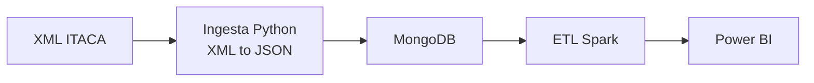

# Proyecto 01 · ITACA

## Descripción y objetivo

Construir un dashboard de análisis académico en Power BI a partir de datos reales de la plataforma ITACA de la Conselleria de Educación, extraídos como ficheros XML.

## Arquitectura



## Fuentes de datos

| Fuente | URL / origen | Formato | Frecuencia de actualización | Licencia | Última ingesta |
|---|---|---|---|---|---|
| ITACA (Conselleria de Educación) | Facilitada por el docente | XML | Única | — | — |

## Estructura del repositorio

| Carpeta / fichero | Contenido |
|---|---|
| `ingesta/` | Scripts de lectura de los XML, conversión a JSON y carga en MongoDB |
| `etl/` | Transformaciones con Spark |
| `dashboard/` | Informe de Power BI |
| `data/exported/` | XML exportados de ITACA |
| `data/raw/` | Datos en bruto: salida de la primera ingesta (XML convertido a JSON) |
| `data/staged/` | Datos intermedios |
| `data/curated/` | Datos finales para el dashboard |
| `docker-compose.yaml` | Servicio MongoDB local para desarrollo |
| `.env` | Variables de entorno. Hay que crearlo a partir de `.env.example` |
| `.env.example` | Plantilla de variables de entorno |

## Cómo desplegar el entorno

```bash
cp .env.example .env     # crea el fichero de variables de entorno (hay que rellenarlo)
docker compose up -d     # levanta los servicios en segundo plano
docker compose ps        # comprueba que los contenedores están en ejecución
```

MongoDB 7 queda expuesto en `localhost:27017`.

## Bitácora de prácticas

### Bloque 0 · Entorno

**Objetivo:** crear el repositorio Git, la estructura de carpetas, el `.gitignore`, el entorno Docker y el README.

**Pasos realizados:**

- Creación de las ramas `main` y `develop` para separar el resultado final del desarrollo.
- Creación de la estructura de carpetas.
- Creación del `.gitignore`.
- Creación del entorno Docker.

**Problemas encontrados y solución:** —

**Resultado:** —

### Bloque 1 · Ingesta

**Objetivo:** leer los XML de ITACA y dejar en `data/raw/` un JSON por tabla (`cursos`, `alumnos`, `contenidos`, `calificaciones`) con el NIA anonimizado. La tabla `grupos` se ignora.

**Pasos realizados:**

- Análisis de los XML de `data/exported/Analisis_Academico/<curso>/`: los datos son atributos de cada nodo, no elementos hijos.
- Escritura de `ingesta/ingesta_itaca_xml.py`.
- El script recorre los 5 cursos (2021-22 a 2025-26) y junta cada tabla en un único JSON.
- `Anyo` se toma del atributo `curso` de la cabecera `<centro>`.
- Solo se extraen los campos del modelo; el resto no llega al JSON.
- El NIA se sustituye por `sha256(NIA)[:10]` en `alumnos.NIA` y `calificaciones.alumno`, calculado una vez por NIA y reutilizado.

**Ejecución:** `python3 ingesta/ingesta_itaca_xml.py` desde la raíz del repositorio.

**Problemas encontrados y solución:** —

**Resultado:** 4 JSON generados en `data/raw/`.

## Decisiones técnicas

| Decisión | Alternativa descartada | Motivo |
|---|---|---|
| MongoDB 7 como almacenamiento | PostgreSQL | Los XML convertidos a JSON encajan como documentos BSON sin diseñar antes un esquema relacional |
| Entorno con Docker Compose | Instalar MongoDB en local | Entorno reproducible: cualquiera lo levanta con un solo comando |
| Ramas `main` y `develop` | Trabajar solo en `main` | Separar el resultado final del desarrollo |

## Incidencias resueltas

| Problema | Causa | Solución |
|---|---|---|
| `docker compose` mostraba un aviso por el atributo `version` del `docker-compose.yaml` | En Compose v2 el atributo `version` está obsoleto y se ignora | Eliminar la línea `version` del fichero |

## Resultado final
